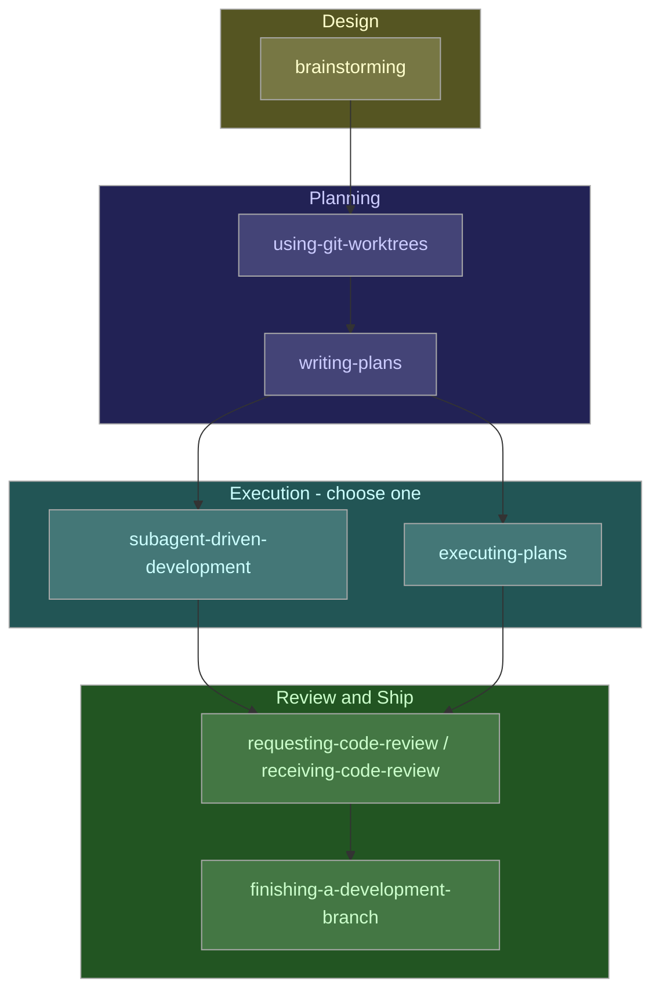
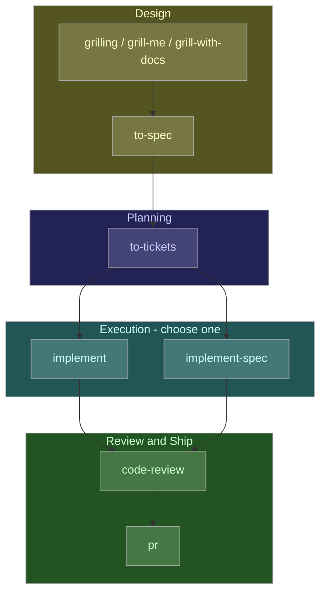

# Superpowers vs. Matt Pocock's Skills: A Comparative Analysis

**Date:** 2026-10-29
**Sources:** Direct examination of official repository checkouts — [`obra/superpowers`](https://github.com/obra/superpowers) and [`mattpocock/skills`](https://github.com/mattpocock/skills) (shallow-cloned 2026-10-29)
**Research artefacts:** `.memory/superpowers-vs-pocock-skills/` (32 verified findings, 6 verified terms, full file/line citations)

---

## Table of Contents

- [What Each Project Is](#what-each-project-is)
- [Where They Overlap](#where-they-overlap)
- [Where They Diverge](#where-they-diverge)
- [Advantages and Disadvantages](#advantages-and-disadvantages)
- [Project Lifecycle in Detail](#project-lifecycle-in-detail)
  - [Superpowers' Enforced Pipeline](#superpowers-enforced-pipeline)
    - [Cross-Cutting Gates](#cross-cutting-gates)
  - [Following the Same Pipeline With Pocock's Skills](#following-the-same-pipeline-with-pococks-skills)
  - [What Else Pocock's Skills Could Add](#what-else-pococks-skills-could-add)
- [Using Both Toolkits in the Same Project](#using-both-toolkits-in-the-same-project)
  - [Which Pocock Skills to Install Alongside Superpowers](#which-pocock-skills-to-install-alongside-superpowers)
  - [A Combined Workflow, Stage by Stage](#a-combined-workflow-stage-by-stage)
- [Research Trail](#research-trail)

---

## What Each Project Is

**Superpowers** (`obra/superpowers`, Jesse Vincent / Prime Radiant) calls itself "a complete software development methodology for your coding agents." It ships exactly **15 skills** in one flat namespace, all general-purpose, wired into one fixed pipeline: brainstorming → worktree setup → writing-plans → (subagent-driven-development | executing-plans) → TDD → code review → finish-branch. Its own `AGENTS.md` explicitly bans domain-specific or project-specific skills from core.

**Pocock's Skills** (`mattpocock/skills`, Matt Pocock / AI Hero) explicitly rejects that framing: its README names GSD, BMAD, and Spec-Kit as cautionary examples of frameworks that "own the process" and "take away your control." It ships **27 promoted skills** (20 engineering + 7 productivity, organised in a five-bucket lifecycle taxonomy — `engineering/`, `productivity/`, `misc/`, `in-progress/`, `deprecated/`), designed to be picked individually rather than run as one pipeline, with a router skill (`ask-matt`) to help you choose.

---

## Where They Overlap

- **Identical base unit.** Both use a `SKILL.md` file (Markdown + YAML frontmatter with at minimum `name`/`description`), loaded by the harness and matched against context — the same "Agent Skill" primitive Claude Code itself defines.
- **Same progressive-disclosure discipline.** Both keep `SKILL.md` short and push detail into companion reference files loaded on demand (Superpowers' TDD skill links out to a testing-anti-patterns reference; Pocock's `tdd` skill links to `tests.md`/`mocking.md`).
- **Convergent core engineering content.** Independently, both arrived at near-identical disciplines for the same two problems: strict red-green-refactor TDD (`test-driven-development` vs `tdd`) and a phase-gated root-cause debugging loop (`systematic-debugging` vs `diagnosing-bugs`).
- **Multi-harness, plugin-based distribution.** Neither is Claude-Code-only; both ship as installable plugins across several agent harnesses, and both are MIT-licensed with a commercial angle behind them (Prime Radiant's enterprise support vs. Pocock's AI Hero newsletter/training business).

---

## Where They Diverge

| Dimension | Superpowers | Pocock's Skills |
|---|---|---|
| **Activation** | Forces its `using-superpowers` bootstrap into every session via code-level `SessionStart` hooks (start/`/clear`/post-compaction) across ~10 harness adapters — "the skills trigger automatically, you don't need to do anything special." | **No hooks anywhere in the repo.** Relies entirely on the harness's native description-matching, plus an explicit `disable-model-invocation` frontmatter flag splitting skills into **user-invoked** (only a human can fire it) vs **model-invoked** (default). |
| **Scope philosophy** | One mandatory pipeline, enforced; domain-specific skills explicitly refused in core. | A large, heterogeneous, opt-in catalogue; new-skill proposals are closed by default if behaviour composes from existing skills. |
| **Distinctive capability** | `diagnosing-superpowers` — reads a session transcript and reports, with line-level evidence, why a skill misfired or was ignored; can package a bug-report bundle. | Shared-vocabulary tooling (`GLOSSARY.md` + ADRs, built/sharpened by `domain-modeling` and `grill-with-docs`) aimed at cutting agent verbosity by giving agent and user the same compressed domain language. Also a reusable `grilling` interview primitive used by five different skills. |
| **Quality assurance** | Treats skill text as "code that shapes agent behaviour": per-harness integration test suites (`tests/`) plus a separate adversarial eval harness (a "Gauntlet QA agent" grading real CLI sessions) — required before any skill-behaviour change merges. | No automated test or eval directory at all. Quality control is social: `SCOPE.md` requires an "observed failure in a real session," not a hypothetical, before any change is even considered. Versioning via Changesets. |
| **Distribution model** | 10 separate native per-harness plugin adapters baked into one repo — deep integration, larger maintained surface. | 3 native self-updating plugins (Claude Code, Codex, Copilot) + a universal `npx skills@latest add` installer that copies **editable** files into your project for every other harness — explicitly trading auto-update for user ownership ("Hack around with them. Make them your own."). |
| **Governance tone** | Famously strict: 94% PR rejection rate, bans "compliance" rewrites against Anthropic's own skills guidance, requires human-authored PR summaries and full contributor/model/plugin disclosure. | Also curated (closed-by-default new skills, frozen `misc/` bucket) but governed through a documented scope bar rather than published rejection-rate shaming. |
| **Telemetry** | Optional, anonymous, version-only telemetry via a remote logo image (opt-out via env var). | None found in README or docs. |

---

## Advantages and Disadvantages

**Superpowers** is strong where a house style must be enforced without being asked: forced hooks mean the methodology actually runs rather than being skippable, and the eval harness gives measurable confidence that skill-text changes do not silently regress agent behaviour. The cost is control: the user gets one opinionated pipeline, a strict contribution bar when shaping it, and more moving parts per harness to keep in sync (10 adapters). It suits teams that want a consistent process across environments and do not need to fork it.

**Pocock's Skills** is strong where pick-and-mix tools under direct control are preferred: the user/model-invoked split and plain file-copy installer mean the user decides exactly what fires and can edit it in place; the glossary/ADR machinery is a distinctive answer to agent verbosity that Superpowers does not attempt. The cost is rigour at the edges: nothing forces any of it to run (it is easy to forget to invoke `grill-me` or `/setup-matt-pocock-skills`), and there is no automated regression testing of skill behaviour — quality depends on Pocock and contributors noticing real failures by hand rather than an eval suite catching them.

In summary: Superpowers prioritises consistent enforcement and measured reliability of one methodology; Pocock's Skills prioritises composability and user control across a wider, more heterogeneous toolbox, at the cost of enforcement guarantees and automated behavioural QA.

---

## Project Lifecycle in Detail

### Superpowers' Enforced Pipeline

Every path through Superpowers converges on one spine, with three cross-cutting gates active throughout rather than confined to a single stage.

Colour key (consistent with the Pocock diagram in [Following the Same Pipeline With Pocock's Skills](#following-the-same-pipeline-with-pococks-skills)): yellow/brown = design, blue/lavender = planning, cyan/teal = execution, green/mint = review and ship.

1. **`brainstorming`** (mandatory before any creative work). First checks whether anything non-trivial is actually missing from the request; if so, it interviews before building, laying out approaches as a separate message the human picks from, then writing a design document (chat-sized for small changes, a full written document for projects), obtaining explicit sign-off, and only then handing off to `writing-plans`. A "spike they said yes to" is the one sanctioned exception to "do not implement yet."
2. **`using-git-worktrees`** (mandatory before executing an approved plan). Detects existing isolation first (so it never creates a duplicate), prefers the harness's native worktree tool over raw `git worktree`, falls back to `.worktrees/` with a `.gitignore` safety check, runs project setup (`npm install`/`cargo build`/etc.), and verifies a clean test baseline before anything is built.
3. **`writing-plans`**. Produces a plan file at `docs/superpowers/plans/YYYY-MM-DD-<feature>.md` with a fixed header (Goal, Architecture, Tech Stack, a link back to the Spec, Global Constraints, Review Focus) and per-task blocks (Files / Interfaces / Steps), where every step is RED → GREEN → COMMIT at the granularity of "the implementer can write exactly one reasonable thing from it." A five-point self-review (spec coverage, step scan, type consistency, Review Focus coverage, proportion) runs before handoff, at which point the human chooses an execution method.
4. **Execution — one of two required sub-skills:**
   - **`subagent-driven-development`**: a fresh implementer subagent per task, tracked in a ledger (`.superpowers/sdd/<plan>/progress.md`), reviewed by a fresh task reviewer (spec compliance **and** code quality, both mandatory) after every single task, with a capped fix loop before anything is marked complete, and explicitly never dispatched in parallel ("never dispatch multiple implementation subagents in parallel (conflicts)"). Model selection is tiered by task complexity, and a final whole-branch review always runs on the most capable available model.
   - **`executing-plans`**: the same plan, the same ledger format (so a plan can switch executor mid-flight), but run inline in one session, with one reviewer at the very end instead of one per task. `test-driven-development` is a required sub-skill loaded before Task 1 regardless of which path is chosen.
5. **`requesting-code-review` / `receiving-code-review`**. Review is dispatched with precisely-crafted context rather than the session's full history, findings are severity-tiered (Critical/Important/Minor), and a separate skill governs how feedback is received: verify before implementing, no performative agreement, a YAGNI check against actual usage before implementing a reviewer's suggestion, and reasoned pushback where warranted.
6. **`finishing-a-development-branch`**. Verify tests are green, detect the environment (normal repository, named-branch worktree, or detached HEAD), confirm the base branch, present exactly three options (merge locally, push and open a pull request, or keep as-is) or two (detached HEAD), execute the choice, then clean up the worktree only if Superpowers created it. Discarding work requires the literal typed word "discard."

#### Cross-Cutting Gates

Active at every step, not a stage of their own:

- **`test-driven-development`** — no production code without a failing test first, enforced identically whichever execution skill is running.
- **`systematic-debugging`** — triggered the instant a step's actual output does not match the plan's expected result; four phases (root cause, pattern, hypothesis, fix), with a rule to stop and question the architecture after three failed fix attempts.
- **`verification-before-completion`** — no completion claim without fresh verification evidence run in the same message; phrases such as "should pass" or "looks correct" are explicitly flagged as violations.

Meta, outside the pipeline: `diagnosing-superpowers` (analyses a session transcript with line-level evidence when the pipeline itself misbehaves) and `writing-skills` (for authoring or editing skills, not projects).

A recurring design feature is worth noting: nearly every skill carries a "Common Rationalisations" or "Red Flags" table, pre-empting the exact excuses an agent under time pressure reaches for ("just this once," "should work now") with the stated reality. This is a deliberate behaviour-shaping device, not incidental prose.

### Following the Same Pipeline With Pocock's Skills

Same colour key as the Superpowers diagram in [Superpowers' Enforced Pipeline](#superpowers-enforced-pipeline), so the two pipelines can be read stage-for-stage against each other.

| Superpowers stage | Pocock equivalent | What differs |
|---|---|---|
| **Bootstrap/forcing** | None. A one-time manual `/setup-matt-pocock-skills` configures the issue tracker, triage labels, and docs layout; nothing forces this or any later step to run. | Superpowers forces its spine with hooks; Pocock has no forcing mechanism anywhere. |
| **`brainstorming`** | Split three ways: `grilling` (the reusable interview primitive, model-invoked) wrapped by `grill-me` or `grill-with-docs` (both user-invoked only, so the model never reaches for them unprompted), then `to-spec` (user-invoked, explicitly does **not** interview — it synthesises what has already been discussed into a fixed template: Problem Statement, Solution, User Stories, Implementation Decisions, Testing Decisions, Out of Scope, Further Notes) and publishes it to the issue tracker with a `ready-for-agent` label. | `grill-with-docs` additionally updates `GLOSSARY.md` and architecture decision records live, a persistent artefact Superpowers' brainstorming has no equivalent of. Because the entry points are user-invoked, nothing requires this stage to run at all, unlike Superpowers, where brainstorming is model-invoked by default and forced into consideration every session. |
| **`writing-plans`** | `to-tickets` (user-invoked): breaks the spec into tracer-bullet vertical-slice tickets with explicit blocking edges, a task graph with a "frontier" of unblocked tickets, plus a dedicated expand-contract sequencing pattern for wide mechanical refactors that cannot be vertical-sliced. | Richer in one respect (an explicit dependency graph rather than a linear task list), thinner in another (a ticket states what to build plus acceptance criteria, leaving step granularity to whichever `tdd` call implements it, where `writing-plans` bakes that granularity into the plan itself). |
| **`using-git-worktrees`** | No standalone equivalent. `implement-spec` creates a worktree per implementer subagent as an implementation detail of that one skill, not a reusable, always-invoked step. | Workspace isolation is implicit in Pocock's Skills, first-class in Superpowers. |
| **Execution (subagent-driven vs inline)** | `implement` (single unit: calls `tdd`, typechecks, calls `code-review`, commits) or `implement-spec` (whole task graph: a fresh implementer subagent per ticket, each on its own worktree, each required to call `tdd`, merged by dedicated merger subagents as the frontier advances, explicitly concurrent, with exactly one `code-review` pass at the end of the whole integration branch, not per ticket). | A genuine philosophical split, not a relabelling: Superpowers' `subagent-driven-development` is sequential by design, citing conflicts as the reason; Pocock's `implement-spec` is concurrent by design across the ticket frontier. |
| **`test-driven-development`** | `tdd`: close to identical — seams over implementation detail, named anti-patterns (implementation-coupled, tautological, horizontal slicing), red before green. Pocock's variant adds an explicit step requiring seams to be user-confirmed before any test is written. | Converges almost exactly. |
| **`systematic-debugging`** | `diagnosing-bugs`: close to identical phase-gated root-cause loop. | Converges almost exactly. |
| **`requesting-code-review`** | `code-review` (model-invoked): two parallel sub-agents, Standards (repository conventions plus a built-in baseline of twelve named Fowler code smells) and Spec (coverage, scope creep, wrong implementation), reported side by side and never cross-ranked. | Pocock's two-axis split directly prevents one axis masking the other; Superpowers' single-axis, severity-tiered reviewer has no structural guard against that failure mode. |
| **`receiving-code-review`** | No equivalent. | A real gap on Pocock's side: nothing written down about verifying feedback before acting on it. |
| **`finishing-a-development-branch`** | No dedicated equivalent. `implement-spec`'s closing step ("mark the pull request ready for review, or resolve each ticket, and report the integration branch") is one step inside one skill, not a reusable, environment-aware, menu-driven stage every path ends at. | Superpowers treats "how does this land" as first-class; Pocock's Skills treats it as a closing step of one skill. |
| **Pull request authorship** | `pr` (model-invoked): a dedicated template — Summary (a diagram, diff sketch, or tree, matched to what is changing), Evidence (before/after), Merge Danger (one-way versus two-way door, blast radius). | Superpowers has no equivalent; `finishing-a-development-branch` only says to follow the repository's existing pull request template. |
| **`verification-before-completion`** | No standalone, named equivalent. The discipline is scattered across `implement`'s closing test run and `code-review`'s smell baseline rather than a single, quotable, independently-invokable gate. | A real gap on Pocock's side. |
| **`diagnosing-superpowers`** | `retro` is the nearest analogue, but forward-looking (suggesting environment, tooling, and coding-standard improvements for future sessions) rather than transcript forensics for this specific misfire. | Different purpose in either direction, not a true substitute. |

### What Else Pocock's Skills Could Add

Several Pocock skills have no Superpowers pipeline stage at all:

- **`wayfinder`** — resolves work "too big for one agent session" through decision tickets before a spec exists. Superpowers' `brainstorming` assumes the whole feature resolves to one spec in one sitting; nothing in Superpowers handles multi-session-scale ambiguity.
- **`domain-modeling` / `GLOSSARY.md` / architecture decision records** — a persistent, project-wide shared-vocabulary artefact actively consumed by `to-spec`, `to-tickets`, `code-review`, `pr`, and `wait-what`. Superpowers' plans reference domain language implicitly but build nothing that accumulates across features.
- **`triage`** — a state machine for incoming issues and external pull requests. Superpowers has nothing for the user's own project issue intake.
- **`improve-codebase-architecture`** — proactive, request-independent scanning for structural debt, presented as a visual HTML report.
- **`codebase-design`** — a standing deep-module and seam vocabulary other skills explicitly borrow terms from.
- **`prototype`** — bounded throwaway spikes to answer a design question. Superpowers only gestures at "a spike they said yes to," with no skill defining how to bound one.
- **`wizard`** — generated interactive bash wizards for steps only a human can perform, such as provisioning credentials or walking an unfamiliar dashboard.
- **`research`** — a background-agent, primary-source-cited research skill.
- The entire `productivity/` bucket (`handoff`, `teach`, `to-questionnaire`, `wait-what`) — non-code workflow tooling, outside Superpowers' deliberately engineering-only scope.

---

## Using Both Toolkits in the Same Project

The two catalogues share no skill names, so nothing stops a user installing both into one harness. What makes the combination work is choosing which of Pocock's skills to install, and which stage of a single project each one is reached for, not changing either framework's own files.

### Which Pocock Skills to Install Alongside Superpowers

Install Superpowers in full; its hooks are what keep the enforced spine running. From Pocock's Skills, add only the skills that fill a stage Superpowers' spine leaves open, and leave out the ones that cover ground Superpowers' own model-invoked skills already cover. Two model-invoked skills matching the same trigger condition give the model two equally plausible places to reach for the same job, with nothing to arbitrate between them consistently from one session to the next.

| Install (covers a stage Superpowers has nothing for) | Leave out (covers the same stage as a Superpowers skill) |
|---|---|
| `wayfinder`, `triage`, `domain-modeling`, `codebase-design`, `prototype`, `wizard`, `research`, `improve-codebase-architecture`, `retro`, `pr`, `grill-me`, `grill-with-docs`, `to-spec`, `to-tickets`, `ask-matt`, `setup-matt-pocock-skills`, and the whole `productivity/` bucket | `tdd` (same stage as `test-driven-development`), `diagnosing-bugs` (same stage as `systematic-debugging`), `code-review` (same stage as `requesting-code-review`), `implement` and `implement-spec` (same stage as `subagent-driven-development` / `executing-plans`) |

### A Combined Workflow, Stage by Stage

1. **Work too large or too vague for one session.** Run Pocock's `wayfinder` first, independent of Superpowers entirely, resolving a shared map of decision tickets down to a destination a single feature's `brainstorming` can actually interview against.
2. **Starting a feature.** Let Superpowers' hook-forced `brainstorming` run as normal. With `domain-modeling` also installed, the model can reach for it during that same conversation to capture and sharpen terms into `GLOSSARY.md` and architecture decision records as they come up, without running a second, separate interview.
3. **Planning.** Superpowers' `writing-plans` runs as normal, now able to read the glossary just captured for naming consistency across tasks.
4. **Incoming issue backlog.** Use Pocock's `triage` to move issues and external pull requests through its state machine before any of them reach step 1 or step 2.
5. **Implementation.** Keep Superpowers' `subagent-driven-development` / `executing-plans` plus `test-driven-development` / `systematic-debugging` as the only execution path in use; this is exactly why `tdd`, `diagnosing-bugs`, `implement`, and `implement-spec` were left uninstalled above.
6. **A manual, human-only step appears mid-task** (provisioning a credential, walking an unfamiliar dashboard, a one-off migration). Invoke Pocock's `wizard`; Superpowers has nothing for this.
7. **Review.** Keep Superpowers' `requesting-code-review` / `receiving-code-review` as the one review gate in use; this is why Pocock's `code-review` was left uninstalled too, since running two independent reviewers on the same diff is cost without a corresponding benefit.
8. **Shipping.** When Superpowers' `finishing-a-development-branch` reaches "push and open a pull request," invoke Pocock's `pr` before opening it, to author the body. This is the one point in the workflow where a skill from each framework runs back-to-back by design: Superpowers has no pull-request-body guidance, and Pocock's `pr` has no competing "how does this land" menu of its own, so there is nothing to arbitrate between.
9. **After the branch lands, independent of any specific feature.** Run Pocock's `improve-codebase-architecture` and `retro` on a regular schedule; neither needs a feature in flight to be useful, and neither has a Superpowers equivalent.

---

## Research Trail

Every claim above, including the lifecycle and cross-strengthening sections, traces back to a specific finding with an exact file/line citation in `.memory/superpowers-vs-pocock-skills/superpowers-vs-pocock-skills-facts.md` (32 verified findings), indexed in `superpowers-vs-pocock-skills-index.md`, with key terminology (Agent Skill, SKILL.md, Progressive Disclosure, Model-invoked Skill, User-invoked Skill, SessionStart Hook) defined in `superpowers-vs-pocock-skills-terms.md`.
